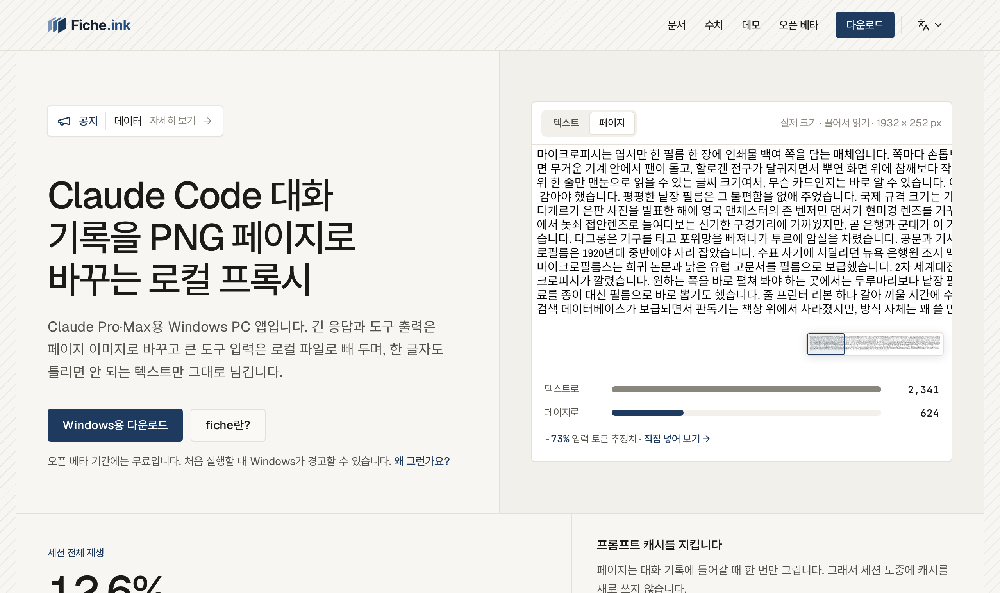
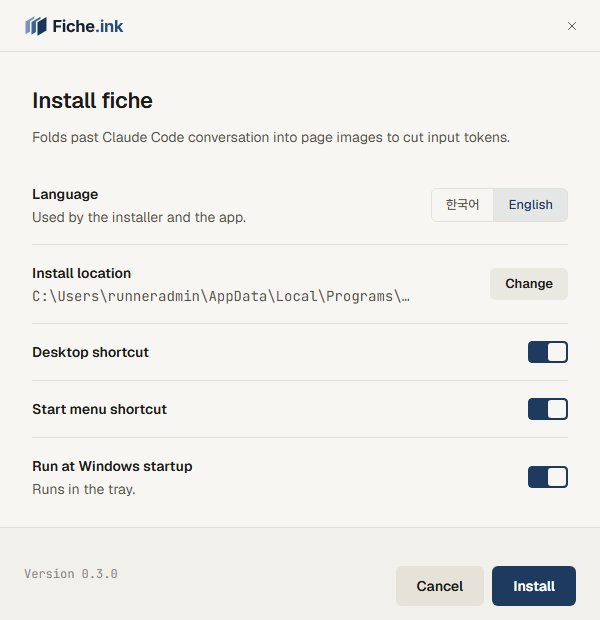

  <a href="https://fiche.ink/ko/">
    <picture>
      <source media="(prefers-color-scheme: dark)" srcset=".github/assets/logo-dark.svg">
      
    </picture>
  </a>

<b>Claude Code 대화 기록을 페이지 이미지로 접어서 입력 토큰을 줄이는 Windows 앱</b>

  <a href="https://github.com/fiche-ink/fiche/releases/latest/download/fiche-setup-x64.exe"><b>Windows용 다운로드</b></a> ·
  <a href="https://fiche.ink/ko/">fiche.ink</a> ·
  <a href="https://fiche.ink/ko/demo">라이브 데모</a> ·
  <a href="README.md">English</a>

## fiche가 하는 일

Claude Code는 요청마다 지난 대화를 전부 다시 보냅니다. 오래 쓴 세션일수록 앞부분에 쌓인 긴 도구 출력, 답변, 시스템 알림이 매번 다시 실립니다.

fiche는 PC에서 로컬 프록시로 돌면서 그 앞부분을 정리합니다.

- 큰 블록은 **페이지 이미지**로 그립니다. 같은 내용을 이미지로 보내면 대체로 입력 토큰이 적게 듭니다.
- 무거운 도구 입력은 **로컬 파일로 옮기고**, 대화에는 짧은 자리표시만 남깁니다.
- 경로, URL, 해시, 오류 문구처럼 **정확해야 하는 글자는 텍스트로 둡니다.**
- 페이지는 블록이 대화에 들어올 때 한 번만 그리고 다시 바꾸지 않습니다. 그래서 프롬프트 캐시가 깨지지 않습니다.

쓰던 Claude Pro·Max 플랜을 그대로 씁니다. Claude 요청은 내 PC에서 내 Claude 로그인으로 Anthropic에 바로 갑니다.

## 시작하기

1. [설치 파일](https://github.com/fiche-ink/fiche/releases/latest/download/fiche-setup-x64.exe)을 받아 실행합니다. 베타 동안은 코드 서명이 없어 Windows가 처음 실행할 때 경고를 띄울 수 있습니다.
2. 앱에서 **로그인**합니다. GitHub이나 Google 계정을 씁니다.
3. 끝입니다. Claude Code가 설치돼 있으면 fiche가 알아서 연결합니다. fiche를 끄면 Claude Code 설정이 원래대로 돌아갑니다.

## 요금

오픈 베타 동안은 무료입니다. 카드를 등록할 필요가 없습니다. 유료 요금제는 베타가 끝난 뒤에 시작하며 미리 공지합니다. 자세한 내용은 [필름과 요금](https://fiche.ink/ko/pricing)에 있습니다.

## 개인정보

원문은 PC 밖으로 나가지 않습니다. 블록을 이미지로 바꿀지는 판정 서버가 정하는데, 판정 서버에는 블록마다 숫자(길이, 줄 통계, 글자 종류 비율 등)와 종류 태그만 갑니다. 텍스트, 코드, 파일 경로는 보내지 않습니다.

이 저장소에는 네트워크를 쓰는 클라이언트 소스가 들어 있습니다. 위 설명이 맞는지 코드와 실제 트래픽으로 직접 확인할 수 있습니다. 방법은 [VERIFY.md](VERIFY.md)에 있습니다.

## 라이선스와 문의

MIT 라이선스입니다. 자세한 내용은 [LICENSE](LICENSE)에 있습니다. 문의는 hello@fiche.ink로 보내거나 [이슈](https://github.com/fiche-ink/fiche/issues)를 남겨 주세요.
