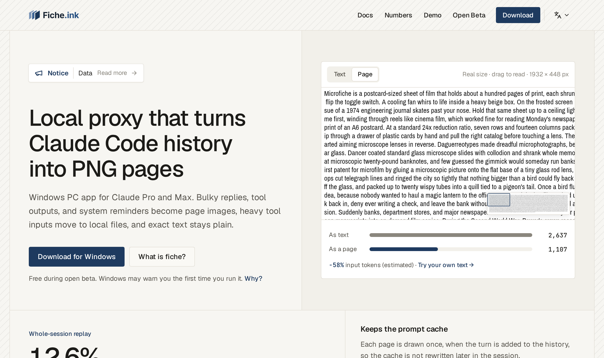
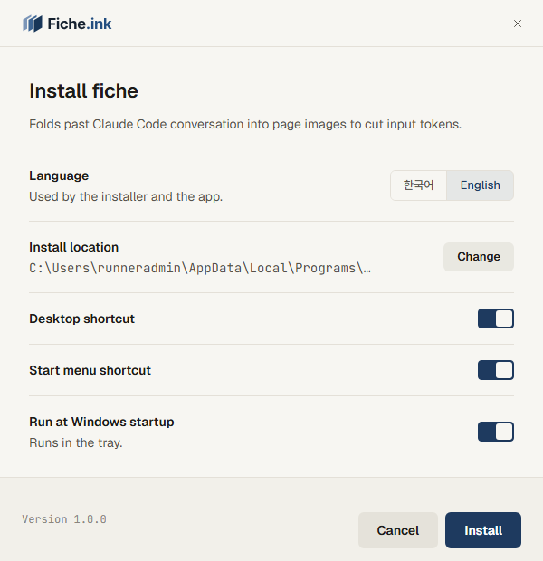

  <a href="https://fiche.ink">
    <picture>
      <source media="(prefers-color-scheme: dark)" srcset=".github/assets/logo-dark.svg">
      
    </picture>
  </a>

  <b>A local proxy that turns old Claude Code history into page images, so every request sends fewer input tokens.</b> 
  Windows · Claude Pro and Max · free during the open beta

  <a href="https://github.com/fiche-ink/fiche/releases/latest/download/fiche-setup-x64.exe"><b>Download for Windows</b></a> ·
  <a href="https://fiche.ink">Website</a> ·
  <a href="https://fiche.ink/demo">Try it in your browser</a> ·
  <a href="README.ko.md">한국어</a>

  

## Why

Claude Code resends the whole conversation with every request. Long sessions fill up with tool outputs, file dumps and long replies that the model rarely needs word for word again, and they count against your usage limit each time.

fiche sits between Claude Code and Anthropic on your own PC. When a block of history is big enough, it draws that block as a page image the first time it appears. A page of text costs far fewer input tokens as an image than as text, and since each page is drawn once and never changes, the prompt cache keeps working.

- **Bulky history becomes pages.** Long replies, tool outputs and system reminders turn into page images. Heavy tool inputs, such as whole files written with Write, move to local files the model can read again.
- **Exact text stays text.** Paths, URLs, hashes, IDs and error lines inside a block are kept as plain text next to the image, so nothing that must be copied exactly is left to the model's eyes.
- **Your login stays yours.** Requests go straight from your PC to Anthropic with your own Claude login. fiche never sees or stores it, and it does not resell Claude access.

## Get started

1. [Download the installer](https://github.com/fiche-ink/fiche/releases/latest/download/fiche-setup-x64.exe) and run it. The installer is unsigned during the beta, so Windows may warn you the first time ([why](https://fiche.ink/download)).
2. Open fiche and click **Sign in**. Your browser opens; sign in with GitHub or Google.
3. Keep using Claude Code as usual. fiche connects to it automatically, and the home screen shows how many input tokens each request saved.

Turning fiche off in the app puts Claude Code back exactly as it was.

## Pricing

Free during the open beta, no card needed. Paid plans start after the beta and will be announced first.

| After the beta | Price | Film |
|---|---|---|
| Sign-up | Free | 50 frames, once |
| Film pack | $5 | 2 rolls |
| Film pack | $10 | 5 rolls |
| Film pack | $20 | 10 rolls |

1 roll = 100 frames = $2, about a month of Claude Pro. Bought film never expires.

Early testers who meet the conditions within 14 days of signing up get **5 rolls** at launch. Details: [Film and pricing](https://fiche.ink/pricing).

## Privacy

Your conversation text never leaves your PC except on its normal way to Anthropic. To decide which blocks become pages, the app sends the fiche judge server a few numbers per block (length, line statistics, character mix) and gets a decision back. With **Data contribution** on, those decisions, outcome signals and a shape-only copy of each block (every letter replaced by its class, such as `a`, `A`, `0`) are kept to improve the judge. Turn it off in Settings and nothing is stored for training.

Details: [Privacy policy](https://fiche.ink/privacy) · [How we collect data without your text](https://fiche.ink/notice/2026-11-18-shape-data)

## What is in this repository

Because fiche sees your Claude Code traffic, the network-facing part of the app is published here so you can check it yourself:

| File | What it does |
|---|---|
| `client/src/net.js` | The one module every fiche request goes through |
| `client/src/proxy.js` | The local proxy between Claude Code and Anthropic |
| `client/src/account.js` | Sign-in and the account calls to `api.fiche.ink` |
| `client/src/engine.js` | Loads the compression engine and hands it its network function |
| `client/src/claude.js` | Writes and restores the Claude Code settings |
| `client/src/setup.js` | Installer and uninstaller (no network) |
| `client/src/meter.js` | The savings meter |

The compression engine itself ships inside the installed app as `engine/v0.mjs` (readable JavaScript, outside `app.asar`). It has no network access of its own.

[VERIFY.md](VERIFY.md) explains how to check every claim above: read the network module, compare the installed app with this source, read the in-app **Sent log**, or decrypt the app's traffic in Wireshark.

## Feedback

Bugs and questions: [open an issue](https://github.com/fiche-ink/fiche/issues) or write to hello@fiche.ink.

## License

The client source in this repository is MIT licensed. See [LICENSE](LICENSE). The judge server is not part of this repository.
